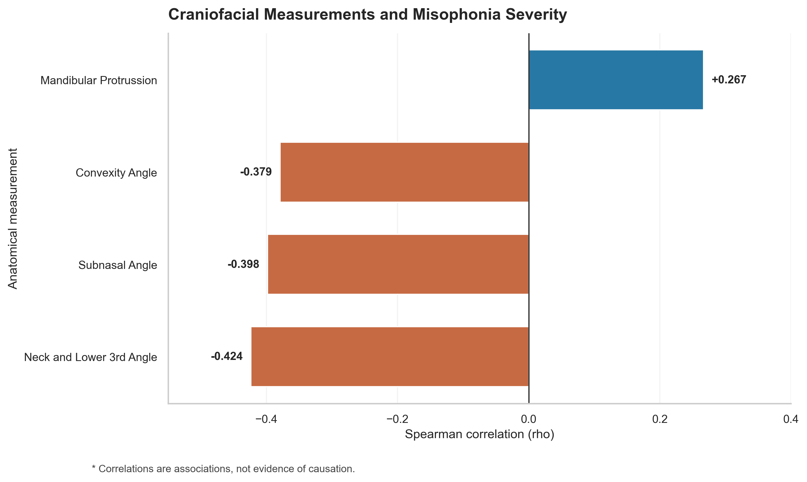
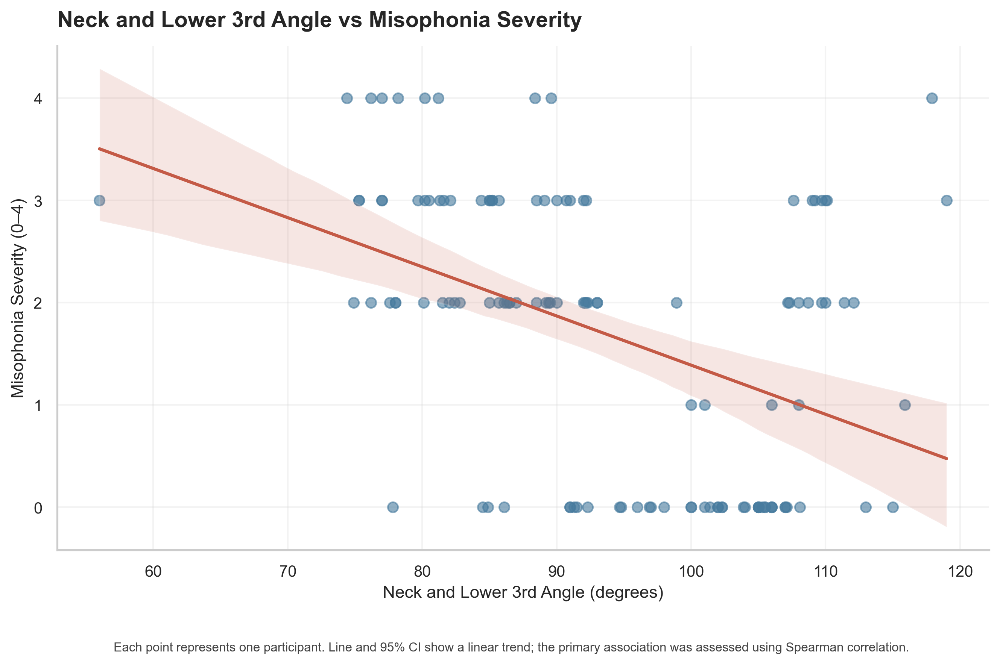
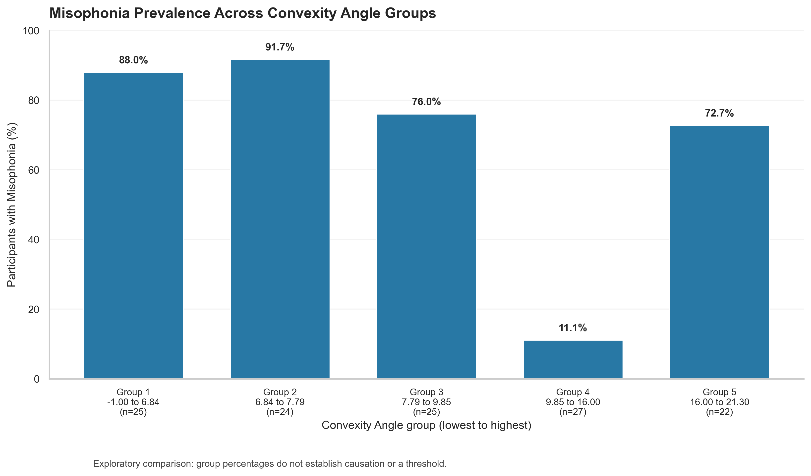

# Misophonia and Craniofacial Measurements

A statistical analysis of the associations between craniofacial measurements and misophonia severity.

## Research question

Are selected craniofacial measurements associated with self-reported misophonia severity?

This project explores the relationships between four anatomical measurements and misophonia severity using descriptive visualisations and Spearman rank correlations.

The analysis investigates associations, not causation.

## Dataset

- **Source:** [Misophonia dataset](https://alejandro-isglobal.github.io/SDA/Misophonia.txt)
- **Sample size:** 123 observations
- **Variables:** 21

The analysis focuses on four anatomical measurements:

- Neck and Lower 3rd Angle
- Subnasal Angle
- Convexity Angle
- Mandibular Protrussion

Misophonia severity is analysed on an ordinal scale from 0 to 4. A separate exploratory analysis compares the percentage of participants with misophonia across groups of Convexity Angle.

## Methods

- Data loading and preparation using pandas
- Spearman rank correlations between anatomical measurements and misophonia severity
- Holm correction for multiple statistical tests
- Scatter plot with a fitted linear trend and 95% confidence interval
- Exploratory comparison of misophonia prevalence across five quantile groups of Convexity Angle

## Key findings

All four anatomical measurements showed statistically significant Spearman correlations with misophonia severity after Holm correction.

| Anatomical measurement | Spearman's rho | Holm-adjusted p-value |
|---|---:|---:|
| Neck and Lower 3rd Angle | -0.424 | 0.0000042 |
| Subnasal Angle | -0.398 | 0.0000151 |
| Convexity Angle | -0.379 | 0.0000304 |
| Mandibular Protrussion | +0.267 | 0.002849 |

The strongest association in absolute magnitude was observed for Neck and Lower 3rd Angle (rho = -0.424). Subnasal Angle and Convexity Angle also showed negative associations. Mandibular Protrussion showed a positive association.

These are statistical associations and do not establish causation. Statistical significance alone does not establish clinical importance.

## Figures

### 1. Spearman correlations with misophonia severity

Compares the direction and magnitude of the correlations for all four anatomical measurements.



### 2. Neck and Lower 3rd Angle vs misophonia severity

Each point represents one participant. The fitted line and 95% confidence interval illustrate the linear trend between Neck and Lower 3rd Angle and self-reported misophonia severity. The primary statistical analysis uses Spearman rank correlation; the fitted line is for visual interpretation only.



### 3. Misophonia prevalence across Convexity Angle groups

Shows the percentage of participants classified as having misophonia in five quantile groups of Convexity Angle. This is an exploratory comparison; the observed percentages do not establish a monotonic trend or an anatomical threshold.



## Project structure

```text
misophonia-statistics/
├── figures/
│   ├── angle_by_severity.png
│   ├── misophonia_by_convexity_group.png
│   └── spearman_correlations.png
├── src/
│   └── analysis.py
├── convexity_group_summary.csv
├── correlation_results.csv
├── README.md
├── requirements.txt
└── .gitignore
```

## How to run the analysis

Python 3 is required.

1. Clone the repository and enter its directory:

   ```bash
   git clone https://github.com/dominikaflesinska/misophonia-statistics.git
   cd misophonia-statistics
   ```

2. Install the dependencies:

   ```bash
   pip install -r requirements.txt
   ```

3. Run the analysis:

   ```bash
   python src/analysis.py
   ```

The script downloads the dataset from the source URL, calculates the correlations, applies the Holm correction, saves the result tables, and generates the three figures.

An internet connection is required to retrieve the dataset.

## Limitations

- The dataset contains 123 observations.
- Correlations do not demonstrate causal relationships.
- The exploratory prevalence comparison depends on the chosen grouping of Convexity Angle.
- The results describe this dataset and should not automatically be generalised to other populations.
- Statistical significance does not necessarily imply practical or clinical significance.
